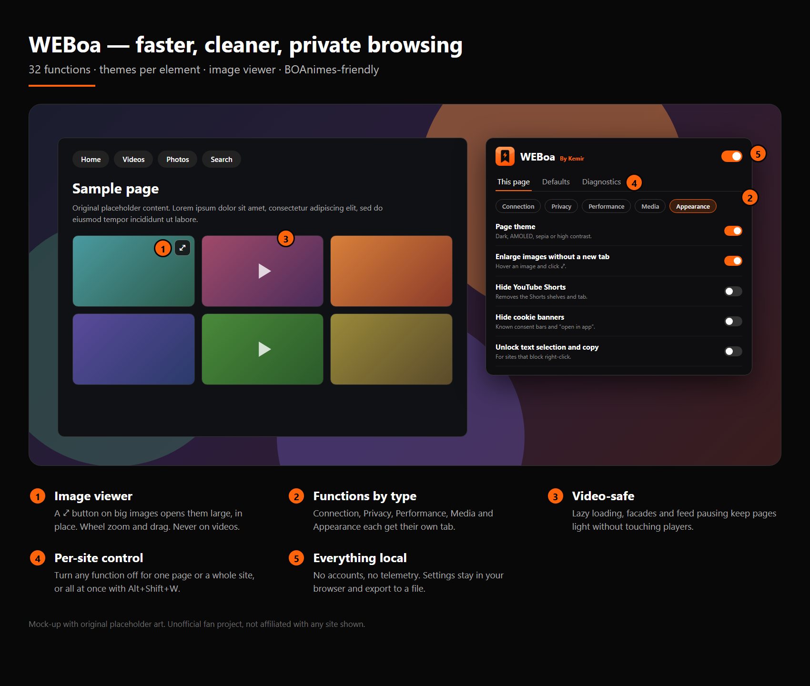
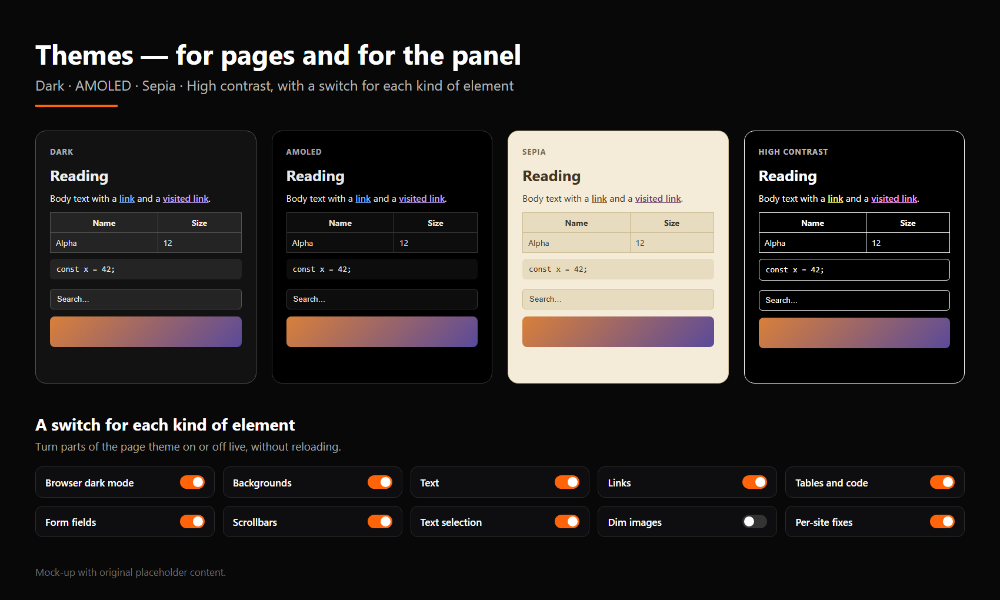

# WEBoa — By Kemir

Extensão para **Chrome, Brave e Edge** (Manifest V3) com foco em **conexão, desempenho bruto e privacidade** em qualquer site. Convive com a extensão [BOAnimes](https://github.com/Kemimir/BOAnimes) na Crunchyroll sem disputar a página.

> Sem contas, sem telemetria, sem servidor: tudo roda e fica no seu navegador. Veja [PRIVACY.md](PRIVACY.md) e [TERMS.md](TERMS.md).

## Instalar (modo desenvolvedor)
1. Baixe ou clone este repositório.
2. Abra `brave://extensions` (ou `chrome://extensions`) e ative **Modo do desenvolvedor**.
3. **Carregar sem compactação** e escolha a pasta [`extensao`](extensao) (a que tem o `manifest.json`).
4. Clique no ícone do raio laranja para abrir o painel.

## O que faz (32 funções)
| Grupo | Funções |
|---|---|
| Conexão | pré-carregar e pré-renderizar a próxima página (regras de especulação), preconnect de terceiros, modo econômico em rede lenta, recarregar imagens que falharam, aviso de conexão, conexões de mídia conhecidas |
| Privacidade | bloquear pop-ups, remover rastreio de cliques (`ping`, redirecionamento do Google), não pedir permissão de notificações, limpar `utm_*`/`fbclid` |
| Desempenho | lazy de imagens e iframes, decodificação assíncrona de imagens, fachadas para YouTube/Vimeo, modo leve de imagens, feeds leves, reduzir animações e transparência |
| Mídia | pausar vídeos mudos fora da tela, pausar vídeo de feed que sai da tela (Instagram, TikTok, X), pausar ao ocultar a aba, reduzir preload, remover autoplay, pausar vídeos que começam sozinhos |
| Aparência | tema das páginas (escuro, AMOLED, sépia, alto contraste), ocultar Shorts do YouTube, ocultar cookies e "abrir no app", ampliar imagens sem abrir outra aba, liberar seleção e cópia de texto, ocultar banners e barras laterais |

Mais no painel: **Vitais da página** (LCP, FCP, CLS, INP), **abas mais pesadas** com botão Suspender, **suspensão automática** de abas inativas, **bloqueio de scripts de terceiros** em 3 níveis, **exclusão por página, por site ou por função**, **modo seguro**, **5 temas do painel**, tema das páginas com chaves por tipo de elemento (fundos, texto, links, tabelas, formulários, barras de rolagem, seleção, imagens) e **exportar/importar** configurações e o atalho **Alt+Shift+W** para excluir/incluir a página atual.

## Compatibilidade com a BOAnimes
Em `crunchyroll.com` a WEBoa entra em **modo de convivência**: o bloqueio de pop-ups nem é carregado, só funcionam limpeza de endereço, um preconnect e o aviso de conexão, não há `MutationObserver` e nada mexe em `fetch`, `XMLHttpRequest` ou `addEventListener`. O bloqueio de rede também exclui a Crunchyroll.

## Observações
- O Brave não tem a API de regras de especulação; lá o pré-carregamento usa `<link rel=prefetch>`.
- As funções de risco (modo leve, pausar autoplay, tema, feeds) vêm **desligadas** por padrão.
- A pasta [`teste`](teste) tem os testes locais (ver `COMO-TESTAR.md`); [`legado`](legado) guarda o userscript antigo.

## Licença
[MIT](LICENSE) © 2026 Kemir.

---

### English summary
WEBoa is a Manifest V3 browser extension (Chrome, Brave, Edge) for connection, raw page performance and privacy: link prefetch, lazy loading, YouTube facades, popup blocking, tracker/ping removal, tab suspension, page themes, Core Web Vitals panel and more. It runs entirely locally with no telemetry, and has a coexistence profile for the BOAnimes extension on Crunchyroll. Load the `extensao` folder as an unpacked extension. MIT licensed.
